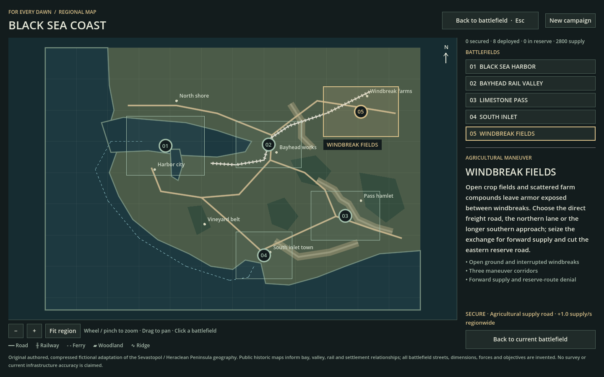

# Regional operations and battlefield authoring

The **Black Sea Coast** atlas offers five independent tactical operations. Their results share an expedition, supply balance and secured-location benefits. Their geometry remains separately authored: matching boundaries, direct adjacency and continuous travel are not required.



## Playing from the atlas

Start with `./tools/play.sh`. A new campaign opens at Harbor; a saved campaign opens its last operation briefing. **REGIONAL MAP** from a briefing/results screen or **REGION** during play opens the atlas.

1. Select a battlefield footprint or its entry to inspect terrain, objectives and the benefit for securing it.
2. Drag to pan; wheel or pinch to zoom. **Fit region**, zoom controls and **Home** restore a useful view.
3. Choose **Open battlefield briefing**, inspect the force and mission, then deploy.

Opening the atlas pauses the active battle and blocks tactical commands. Back or **Esc** resumes the same battle with its previous pause state. Selecting a different battlefield during play requires **Withdraw and open briefing**. Withdrawal carries surviving mobile forces and unspent supply but discards that battlefield’s tactical progress. **Esc** first cancels this confirmation.

After defeat, **Retry operation** restores the deployment checkpoint. **New campaign** in the atlas asks for confirmation before resetting forces, supply and secured areas. No battlefield is locked behind adjacency or a prescribed mission sequence.

## The five battlefields

Counts describe checked-in compiled maps, before destruction/construction. Road and rail counts are polyline segments; props include solid objects and flat details.

| Battlefield | Dimensions | Buildings | Props | Road segments | Rock parcels | Rail segments |
|---|---:|---:|---:|---:|---:|---:|
| Black Sea Harbor | 1,024 × 768 | 478 | 1,894 | 130 | Existing Harbor terrain | Existing Harbor infrastructure |
| Bayhead Rail Valley | 448 × 320 | 56 | 244 | 20 | 2 | 7 |
| Limestone Pass | 448 × 320 | 20 | 52 | 19 | 8 | 0 |
| South Inlet | 448 × 320 | 40 | 145 | 14 | 3 | 0 |
| Windbreak Fields | 576 × 384 | 27 | 225 | 18 | 0 | 0 |

| Operation | Distinct tactical rules | Final hold |
|---|---|---:|
| Harbor | Dense streets, garrisons and working-port approaches. Destroying all authored enemy command posts/ammo depots prevents new dispatch. | 90 s |
| Rail Valley | Station provides +2 supply/s; sorting yard +4/s and connected forward reinforcement access. Eastern junction cuts future enemy dispatch. Solid parked wagons divide crossings and sight lines. | 75 s |
| Limestone Pass | Infantry climb the steep ridge lookout. Vehicles approach through graded roads and the hamlet’s broad terrace. Hamlet adds +2 supply/s; hamlet and crossroads together cut future dispatch. | 45 s |
| South Inlet | Captured quay/inlet head and an uncontested friendly ship in the marked sea lane jointly provide +4 supply/s. Final hold also requires naval control. | 60 s |
| Windbreak Fields | Open agricultural maneuver across a fast central freight road, northern lane or long southern flank. Grain exchange adds +3 supply/s and forward arrivals; east checkpoint cuts future dispatch. | 55 s |

Every land objective must be owned and free of enemy contest through the final hold. The existing reserve-resolution gate remains: preventing dispatch differs from fighting a reserve already in the field. Facility income stops when its requirements fail. Forward arrivals still need safe space and a footprint-valid route from the original insertion. Losing a route-denial objective reopens dispatch; existing enemy units retain their orders and health.

Inlet’s sea lane requires the shore prerequisites plus an effective, non-retreating friendly ship inside the zone, with no enemy ship there. Its HUD reports lane control without revealing an unseen enemy’s identity or position. Boats supporting from elsewhere do not satisfy the zone.

Harbor, Rail Valley, Pass and Inlet author 3,200 initial supply and 6/s base income; Fields authors 2,800 and 3.5/s. These starting balances apply when beginning an expedition. Later deployments use saved supply and survivors instead of adding another free starting army. The numbers remain provisional balance values.

Inland operations offer land and air reinforcements. Harbor and Inlet also support naval units. Existing engineer works, garrisons, suppression, destruction and asset footprints are shared across all maps. Human playtesting has not established comparative difficulty or long-session balance.

Current native review captures show the [operation briefing](images/regional-operations-briefing.png), [Windbreak Fields](images/regional-windbreak-fields.png), [walkable pass](images/regional-limestone-elevation.png) and [Inlet sea-control zone](images/regional-sea-control.png). These staged paused views establish composition and interface evidence; they do not establish battle balance or frame-rate acceptance.

## Campaign persistence

The local operational save is `user://regional_campaign.json` in Godot’s For Every Dawn user-data folder. It records the deployment checkpoint and each victory, defeat or withdrawal:

- Surviving mobile units replace the next battlefield’s authored starting force.
- Infantry retain individual HP, LIGHT/SEVERE wounds, remaining bleed time and KIA slots. Transferring does not heal or resurrect them.
- Vehicles retain integrity, crew losses, mobility/gun/optics damage, ammunition and remaining fire/flood hazards.
- Incompatible units, such as ships on an inland map, remain in reserve until a compatible deployment. A crowded arrival waits for room. Parked units do not simulate while off-map.
- Remaining supply carries forward. Paid purchases still waiting off-map are refunded once at outcome; built structures do not transfer.

Victory secures the location. The following unique benefits apply on later deployments and are separate from the local facility income above:

| Secured location | Regional consequence |
|---|---|
| Black Sea Harbor | +1 supply/s |
| Bayhead Rail Valley | +2 supply/s |
| Limestone Pass | First enemy reserve dispatch delayed by 45 seconds |
| South Inlet | +1 supply/s |
| Windbreak Fields | +1 supply/s |

Replaying a victory cannot stack the same benefit. Defeat or withdrawal releases that battlefield; other secured locations remain. The atlas shows ownership, benefits, force counts and supply. Defeat retry restores the pre-battle force, budget and strategic state through an explicit player action.

**This is checkpoint/outcome persistence.** Closing an unfinished battle returns to its deployment checkpoint. Positions, orders, enemy formations, engineered structures, world damage and elapsed battle time are not saved. Revisiting a battlefield creates a fresh tactical world, and redeployment between locations is abstracted.

A valid previous save is retained as a backup. Corrupt primary data can recover from it; if both copies fail validation, automatic overwrite is blocked until an explicit confirmed reset. Write errors are reported. The current save format accepts at most 256 mobile formations including parked units; exceeding that bound reports an error instead of truncating the force. Campaign tests use isolated paths; ordinary scripted review scenes do not touch the player’s campaign.

## Elevation on Limestone Pass

The pass is the first authored relief map. An eight-unit lookout plateau has a steep ramp accessible to infantry; the upper hamlet occupies a six-unit terrace with gentler road access. Existing rock parcels remain solid outcrops around these traversable surfaces.

The shared height model affects navigation, speed, visibility, weapon line of fire, unit placement and screen picking. Infantry, tracked and wheeled mobility use different maximum grades. Advantages come from physical sight and access, without a damage multiplier. Maps without height patches retain their flat ground.

The current system uses flat plateaus with smooth exterior ramps, combined by maximum height where patches overlap. It does not model erosion, terrain deformation, vehicle suspension or full per-foot IK. Rigid buildings must rest on near-level terraces; the compiler rejects footprints whose sampled foundation height varies by more than 0.5 units.

## Geographic basis and level of fidelity

The region is an original, compressed fictional adaptation of **Sevastopol and the Heraclean Peninsula**.
The atlas uses an abstract 1,200 × 840 coordinate space with north at the top.
Its organizing pattern is a western harbor, eastern rail-and-river valley, southeastern limestone corridors, southern inlet and agricultural hinterland.
Road and ferry lines provide regional context; they do not prescribe adjacent tactical boundaries or simulate inter-map movement.

The historical references support broad relationships between bays, relief, settlements, transport and agricultural hinterland.
UNESCO's account of Chersonese and its chora also informs the distinction between urban blocks and surrounding land allotments and vineyards.
The detailed streets, dimensions, buildings, forces and objectives in the game are authored for play.
The maps are not survey reconstructions, modern infrastructure inventories, GIS tile crops or imports of current street data.
Historical transport references should not be read as evidence of present-day railway operation.

Sources, also recorded in the [regional manifest](../resources/regions/black_sea_region.json):

- [UNESCO — Ancient City of Tauric Chersonese and its Chora](https://whc.unesco.org/en/list/1411/): historic urban organization and agricultural hinterland morphology.
- [University of South Florida, Maps ETC — Sebastopol and Western Crimea, 1919](https://etc.usf.edu/maps/pages/2500/2582/2582.htm): broad coast, relief, railway-valley and settlement relationships.
- [Library of Congress — Plan de la Chersonèse](https://www.loc.gov/item/2002695526/): historical peninsula and bay relationships.

No source map imagery is bundled into these battlefields, and historical troop positions and fortifications are not reproduced.
The manifest and each blueprint preserve their attribution so future edits retain the distinction between reference geography and invented tactical detail.

## Author a plausible place

Start with terrain and access, then add the settlement and its working details.
Keep a clear reason for a road, siding, yard, building entrance or waterfront structure to exist.
The compiler reuses the [Harbor street and district pipeline](harbor-city-design.md) and the [environment library's physical contracts](environment-library.md).

- **Roads and districts:** connect streets to destinations and alternative approaches. Give each district a morphology, then preview the frontage and plots generated from its streets. Keep service access around industrial buildings and leave useful openings through settlement edges.
- **Railways:** connect a main line and sidings with gentle changes of direction. Reserve ballast corridors, put freight activity beside them and keep parked wagons aligned with the track. Road crossings remain at ground level.
- **Coasts and rivers:** use water polygons for actual water. Route land access around the bank; a road drawn across water does not create a bridge. Keep bank-mounted infrastructure on land and boats on supported water.
- **Rock, relief and woodland:** use solid outcrops for barriers and elevation patches for walkable heights. Keep level building terraces and graded vehicle approaches; test infantry routes separately from armor. Preserve body width at bends and useful windbreak/woodland openings.
- **Landmarks and detail:** choose an existing building family or registered asset with a sensible purpose. Explicit landmarks belong to a district; their footprint, storeys and rotation must respect that family's dimensions.

Buildings retain their existing ground-body collision, cover and garrison behavior.
Scenery uses the shared registered footprint and physical class; flat markings, solid props and crushable street furniture keep their existing distinctions.
Rocks remain solid movement/sight blockers. Elevation is an additional shared ground surface, with physical grade and occlusion rules.
Tracks are static traversable scenery and parked wagons are solid props. Railway logistics use captured-facility effects; moving trains, bridges, tunnels and amphibious unloading remain unimplemented.

## Launch the visual editor

From the repository root, run:

```sh
./tools/edit_region.sh
```

On macOS, **Map Editor.command** provides the same launcher by double-clicking it.
The editor requires Python 3 and a browser; its server uses the Python standard library and listens on localhost.
Keep the launcher terminal open. **Ctrl+C** stops it.
Use `./tools/edit_region.sh --no-browser` to print the complete session link, or add `--port 8765` to choose a port.
If the browser cannot authorize the session, reopen the complete link printed by that launcher.

The selector contains **Bayhead Rail Valley, Limestone Pass, South Inlet and Windbreak Fields**.
Black Sea Harbor still uses its original authoring file and compiler; it is not editable in this visual editor.
The editor edits existing stable map IDs and does not provide a new-battlefield creation wizard.

The [original editor capture](images/regional-editor.png) predates the new Elevation tool and Operation rules inspector.

### Controls and inspection

| Action | Control |
|---|---|
| Select and move an authored object | **Select / move** or **V**, then drag |
| Reshape a selected object | Drag its vertex or corner handles |
| Draw a road, railway, water polygon or district | Choose the tool, click vertices, then **Enter** or double-click |
| Cancel drawing | **Esc** |
| Draw solid ridge, woodland or elevation | Choose the tool and drag a rectangle |
| Set a walkable height | Select an elevation patch; edit **Plateau height** and **Ramp width** |
| Edit mission facilities/prerequisites | Deselect objects; expand **Operation rules** in the battlefield inspector |
| Place a building, detail or objective | Choose the tool and click; **B** selects Building, **P** selects Detail |
| Pan | Middle drag or **Space + drag** |
| Zoom and fit | Wheel at the pointer, **+ / −**, **Fit**, or **F** |
| Undo / redo | Toolbar buttons or **Ctrl/Cmd+Z** / **Ctrl/Cmd+Shift+Z** |
| Duplicate or delete | Inspector buttons; **Delete/Backspace** removes the selection |
| Save and compile | **Save & build** or **Ctrl/Cmd+S** |

The inspector exposes exact coordinates, road width/class/purpose, district morphology, building family/dimensions/storeys/district, rotation and prop context/domain.
The vertex editor accepts exact JSON coordinates when dragging is insufficient.
Existing insertion points, open spaces and ground-condition areas can also be selected from the authored-object list.
Insertion points cannot be deleted through the editor. Objectives used by operation rules must have those references removed before deletion; unrelated deletions remap later objective indices. Elevation contours show the external ramp around the plateau.
Shortcuts operate outside text-entry fields; normal text editing retains its keyboard behavior.

Toggle **Generated buildings**, **Physical footprints**, **Districts & land use** and **Snap to 1 unit** to inspect different layers.
Generated frontage is derived content: change the street or district and rebuild it with Preview.
Use an explicit Building landmark when a particular building needs individual placement and editing.
Buildings must be placed inside a district; drawing a new district first makes that relationship explicit.
The compiled overlay fades after source edits, indicating that it no longer represents a freshly validated draft.

### Preview, save and exchange

1. Edit the source geometry and choose **Preview**. The server validates and compiles the draft without writing either repository file.
2. Inspect the resulting frontage, physical footprints and building/prop/solid counts. Correct reported placement or route errors and preview again.
3. Choose **Save & build** to repeat validation and write both the blueprint and its compiled playable map.
4. Redeploy the battlefield in the game to load the new configuration; the currently running simulation is not hot-reloaded.

**Export** downloads the current source blueprint as JSON, including unsaved edits.
**Import** replaces the draft after confirmation, supports undo, and automatically previews it; importing does not save it.
Import requires the currently selected map's `scenario.id` and a file smaller than 2 MB.
Use a desktop-width browser window to keep the Import and Export toolbar buttons visible.
Switching maps prompts before discarding unsaved work, and closing a dirty editor window triggers the browser's unsaved-change warning.

Save checks the blueprint's on-disk revision both before and after compilation.
An external edit produces a conflict instead of overwriting that file: **Export** the draft, reload the map, reconcile the changes, then import or edit against the current revision and save again.
Each file replacement is atomic and ordinary write failures restore the source where necessary; a sudden process or power loss is not a transaction across the pair.
If the derived file is stale after interruption, regenerate it from the source blueprint with the compiler.
Saving writes local project files; it does not commit or push Git changes.

## Source-to-runtime pipeline

| Location | Responsibility |
|---|---|
| `resources/maps/blueprints/<id>.json` | Editable source: mission rules, elevation, forces, streets, districts, rocks, water, landmarks, decor and railways |
| `tools/regional_map_schema.py` | Structural, geometric, asset and placement-domain validation |
| `tools/build_region_maps.py` | Deterministic compile through the shared Harbor generator, followed by placement and route checks |
| `resources/maps/region/<id>.json` | Derived external configuration consumed by the game |
| `resources/regions/black_sea_region.json` | Lightweight regional geography, connections, battlefield bounds, stable IDs, paths and provenance |
| `scripts/region_catalog.gd`, `scripts/scenario_catalog.gd` | Load regional metadata and resolve a selected external battlefield lazily |
| `scripts/operation_rules.gd` | Live facility, route-denial and naval-control requirements |
| `scripts/elevation.gd` | Height, grade, surface normals, ray picking and height occlusion |
| `scripts/regional_campaign.gd` | Operational checkpoint/outcome save, surviving force, supply and regional consequences |

Blueprint `scenario.id`, filename, manifest `scenario_id` and runtime configuration `id` must agree.
New battlefield entries use `map_path: "res://resources/maps/region/<id>.json"`.
Harbor's manifest entry resolves its existing scenario without an external path.
Legacy `resources/scenarios.json` and indices 0–6 remain unchanged.

`validate_blueprint(data)` returns a list of issues.
`compile_blueprint(data)` returns the compiled configuration without mutating the source and raises `ValueError` on invalid or unplaceable authored content.
`validate_compiled(config)` returns compiled-world issues; `encode_json(value)` / `serialize_config(value)` produce the canonical saved JSON.
The editor and command-line build use these same functions.

Validation checks finite and bounded geometry, non-self-crossing polygons, supported road/rail widths, district membership and registered building dimensions.
It checks asset land/sea compatibility, aligned rail wagons, unit/insertion footprints, connected land objectives/forward arrivals, and reachable water zones. Mission objective indices, finite income/reserve parameters, naval prerequisites, bounded elevation patches and rigid-building terrace support are validated.
Explicit buildings and decor must be emitted successfully; placement failure is an error rather than a silently dropped authored object.
Procedural frontage and incidental garden furniture are regenerated to fit the available space.
Compiler route checks cover conservative bodies and water connectivity. Native simulation tests remain authoritative for mobility-profile slope access and combat; an infantry lookout need not be reachable by armor.

## Build and verify

Run these commands from the repository root. The game commands use the pinned Godot 4.5.1 setup described in the [README](../README.md).

```sh
# Rebuild all four external maps, or one selected source.
PYTHONDONTWRITEBYTECODE=1 python3 tools/build_region_maps.py
PYTHONDONTWRITEBYTECODE=1 python3 tools/build_region_maps.py --map bayhead_rail_valley

# Check deterministic output without rewriting it, including the unchanged Harbor.
PYTHONDONTWRITEBYTECODE=1 python3 tools/build_region_maps.py --check
PYTHONDONTWRITEBYTECODE=1 python3 tools/build_harbor_map.py --check

# Authoring and editor service regressions.
PYTHONDONTWRITEBYTECODE=1 python3 tools/test_regional_authoring.py
PYTHONDONTWRITEBYTECODE=1 python3 tools/test_regional_editor.py

# Native movement, mission, rendering-contract and atlas checks.
./tools/play.sh --headless --script tests/test_regional_physics.gd
./tools/play.sh --headless --script tests/test_regional_ui.gd
./tools/play.sh --headless --script tests/test_operation_rules.gd
./tools/play.sh --headless --script tests/test_elevation.gd
./tools/play.sh --headless --script tests/test_regional_campaign.gd
```

For visual review with a display and renderer, use `./tools/play.sh --script tests/regional_native_review.gd` and `./tools/play.sh --script tests/regional_ui_review.gd`.
The battlefield review deliberately pauses play and reveals fog for composition inspection; its screenshots do not represent ordinary player visibility.

Authoring verification on **2026-10-25**: **17 Python authoring tests**, **9 editor service tests**, and **7 real-browser editor workflows** passed with zero page errors. Browser workflows exercised the new map selector, elevation drawing, height/ramp edits, duplicate/delete, undo/redo, referenced-objective protection and validated preview; they did not save the temporary test elevation into a shipped map. The four regional outputs reproduce through the deterministic compiler.

Current native mission, elevation, campaign, UI and compatibility results belong in [validation](validation.md) and [Plan 17](plans/17-regional-operations.md). Earlier baseline results remain in [Plan 16](plans/16-regional-map.md); those counts are not presented as verification of the new features.

Mission checks use controlled state to verify capture, reserve timing and hold conditions; they are not full AI battle playthroughs.
Native screenshots establish appearance and composition, not measured frame-rate acceptance.
Human balance, long-session play quality and hardware performance remain to be measured.
