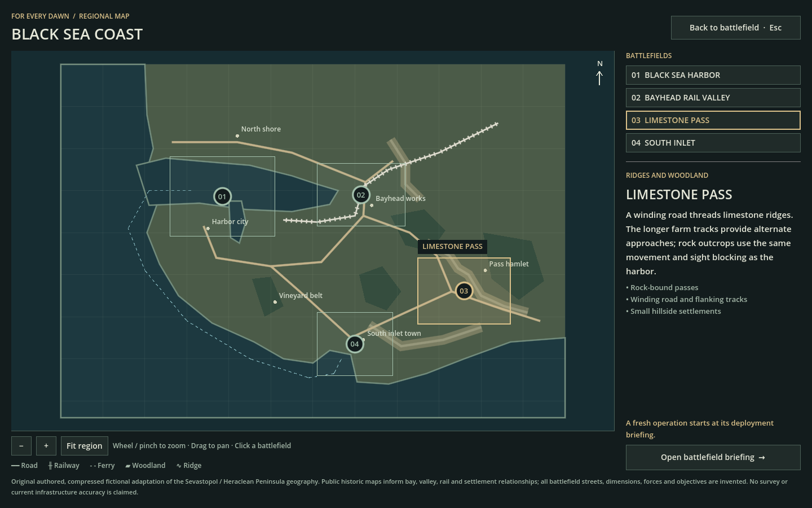
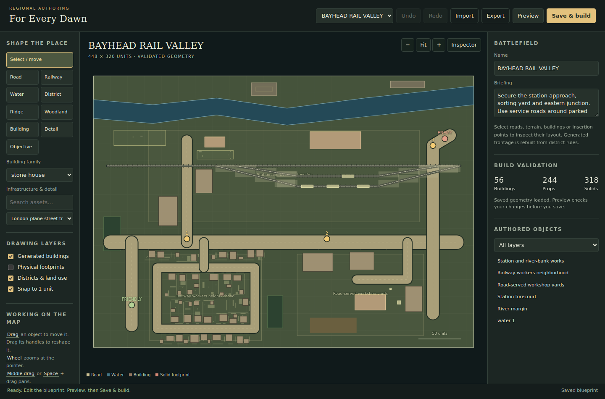

# Regional map and battlefield authoring

The **Black Sea Coast** atlas places Black Sea Harbor and three new battlefields in one readable region.
Roads, railways, settlements, ridges and ferry routes explain how those places relate to one another.
Each location opens its own tactical battlefield, using the existing simulation, assets and physical rules.
The visual editor authors the three new battlefields through the same geometry compiler that produces their playable maps.



## Playing from the atlas

Start the game with `./tools/play.sh` and choose **REGIONAL MAP →** from the briefing.
The same view is available through **REGION** during play and **REGIONAL MAP** on the results screen.

1. Click a battlefield footprint or its entry in the location list to inspect its terrain and features.
2. Drag the map with the left or middle mouse button to pan; use the wheel or a pinch gesture to zoom.
3. Use **Fit region**, the zoom buttons, or **Home** while the canvas has focus to restore a useful view.
4. Choose **Open battlefield briefing →**, inspect the briefing, then deploy normally.

Opening the atlas pauses the active battle and blocks battlefield commands while the map is visible.
**Back to current battlefield**, the back control, or **Esc** returns to that battle and restores its previous pause state.
Switching away from an unfinished battle requires **Leave battle and open briefing**; the confirmation explains that its progress will be lost.
**Esc** first cancels that confirmation. Restart keeps the selected battlefield.

The region has one active tactical simulation at a time.
Its connections establish geographic context; there is no campaign ownership, persistent victory state, inter-map troop movement or supply transfer.
Battlefields are separately loaded maps, rather than seamless sections of a continuously simulated landscape.

## The four battlefields

The following counts describe the checked-in compiled maps, before runtime destruction or construction.
Road and rail counts are individual polyline segments; props include flat details as well as solid objects.

| Battlefield | Dimensions, world units | Buildings | Props | Road segments | Rock parcels | Rail segments |
|---|---:|---:|---:|---:|---:|---:|
| Black Sea Harbor | 1,024 × 768 | 478 | 1,894 | 130 | Existing Harbor terrain | Existing Harbor infrastructure |
| Bayhead Rail Valley | 448 × 320 | 56 | 244 | 20 | 2 | 7 |
| Limestone Pass | 448 × 320 | 21 | 51 | 16 | 8 | 0 |
| South Inlet | 448 × 320 | 40 | 145 | 14 | 3 | 0 |

**Black Sea Harbor** remains the dense urban and working-port anchor of the region.
Its existing scenario and generated geometry are retained; the regional atlas adds a way to reach it alongside the new locations.
See the [Harbor city design](harbor-city-design.md) for its existing district and infrastructure rules.

**Bayhead Rail Valley** combines a main railway, shallow-angle sidings, four parked freight wagons, a station approach and service yards.
Worker housing and workshops connect to a road network beside a river corridor.
The station, sorting yard and eastern junction are the three objectives; exposed level crossings and routes around solid wagons give the approaches different sight lines.
Land and air reinforcements are available. [View the native battlefield capture](images/regional-rail-valley.png).

**Limestone Pass** uses eight solid outcrop parcels to shape a winding main road, with longer western and southern farm-track alternatives.
Small settlements, a service station, woods and pasture provide purposeful destinations along those routes.
Its objectives are the western bend, pass crossroads and upper hamlet.
The current rock model produces low, broad limestone masses: this is a planar valley-and-pass interpretation, with no climbable mountains or elevation combat bonus.
Land and air reinforcements are available. [View the native battlefield capture](images/regional-limestone-pass.png).

**South Inlet** is sea-dominant: approximately 58% of its area is water when sampled on a four-unit grid.
A narrow inlet cuts into the shore, and the land road goes around its head to connect the fishing quay, northern landing and coastal settlement.
The three objectives are the fishing quay, inlet head and northern landing; naval forces have connected water routes alongside the land fighting.
Land, air and sea reinforcements are available. [View the native battlefield capture](images/regional-south-inlet.png).

All three new maps use field operations and three capture objectives, with a configured 60-second hold gate and the existing reserve conditions.
Briefing and mission guidance follow the selected scenario. Inland maps do not offer naval purchases.
These arrangements create different route and visibility problems; their competitive balance has not yet been established by human playtesting.

## Geographic basis and level of fidelity

The region is an original, compressed fictional adaptation of **Sevastopol and the Heraclean Peninsula**.
The atlas uses an abstract 1,200 × 840 coordinate space with north at the top.
Its organizing pattern is a western harbor, an eastern rail-and-river valley, southeastern limestone corridors and a separate sheltered southern inlet.
Road connections link Harbor, Rail Valley, Pass and Inlet; a coastal ferry connection also links Harbor and Inlet.

The historical references support broad relationships between bays, relief, settlements, transport and agricultural hinterland.
UNESCO's account of Chersonese and its chora also informs the distinction between urban blocks and surrounding land allotments and vineyards.
The detailed streets, dimensions, buildings, forces and objectives in the game are authored for play.
The maps are not survey reconstructions, modern infrastructure inventories, GIS tile crops or imports of current street data.
Historical transport references should not be read as evidence of present-day railway operation.

Sources, also recorded in the [regional manifest](../resources/regions/black_sea_region.json):

- [UNESCO — Ancient City of Tauric Chersonese and its Chora](https://whc.unesco.org/en/list/1411/): historic urban organization and agricultural hinterland morphology.
- [University of South Florida, Maps ETC — Sebastopol and Western Crimea, 1919](https://etc.usf.edu/maps/pages/2500/2582/2582.htm): broad coast, relief, railway-valley and settlement relationships.
- [Library of Congress — Plan de la Chersonèse](https://www.loc.gov/item/2002695526/): historical peninsula and bay relationships.

No source map imagery is bundled into these battlefields, and historical troop positions and fortifications are not reproduced.
The manifest and each blueprint preserve their attribution so future edits retain the distinction between reference geography and invented tactical detail.

## Author a plausible place

Start with terrain and access, then add the settlement and its working details.
Keep a clear reason for a road, siding, yard, building entrance or waterfront structure to exist.
The compiler reuses the [Harbor street and district pipeline](harbor-city-design.md) and the [environment library's physical contracts](environment-library.md).

- **Roads and districts:** connect streets to destinations and alternative approaches. Give each district a morphology, then preview the frontage and plots generated from its streets. Keep service access around industrial buildings and leave useful openings through settlement edges.
- **Railways:** connect a main line and sidings with gentle changes of direction. Reserve ballast corridors, put freight activity beside them and keep parked wagons aligned with the track. Road crossings remain at ground level.
- **Coasts and rivers:** use water polygons for actual water. Route land access around the bank; a road drawn across water does not create a bridge. Keep bank-mounted infrastructure on land and boats on supported water.
- **Rock and woodland:** use outcrops to shape sight lines and connected passes. Preserve sufficient width for the actual vehicle footprint, including at bends, and check the longer route as well as the direct one.
- **Landmarks and detail:** choose an existing building family or registered asset with a sensible purpose. Explicit landmarks belong to a district; their footprint, storeys and rotation must respect that family's dimensions.

Buildings retain their existing ground-body collision, cover and garrison behavior.
Scenery uses the shared registered footprint and physical class; flat markings, solid props and crushable street furniture keep their existing distinctions.
Rocks block ground movement and sight under the existing rules. Ground movement remains planar, with no new slopes, height advantage or special mountain physics.
Tracks are static traversable scenery and parked wagons are solid props. Moving trains, rail logistics, bridges, tunnels and amphibious unloading are outside this increment.

## Launch the visual editor

From the repository root, run:

```sh
./tools/edit_region.sh
```

On macOS, **Map Editor.command** provides the same launcher by double-clicking it.
The editor requires Python 3 and a browser; its server uses the Python standard library and listens on localhost.
Keep the launcher terminal open. **Ctrl+C** stops it.
Use `./tools/edit_region.sh --no-browser` to print the complete session link, or add `--port 8765` to choose a port.
If the browser cannot authorize the session, reopen the complete link printed by that launcher.

The selector currently contains **Bayhead Rail Valley, Limestone Pass and South Inlet**.
Black Sea Harbor still uses its original authoring file and compiler; it is not editable in this visual editor.
The editor edits existing stable map IDs and does not provide a new-battlefield creation wizard.



### Controls and inspection

| Action | Control |
|---|---|
| Select and move an authored object | **Select / move** or **V**, then drag |
| Reshape a selected object | Drag its vertex or corner handles |
| Draw a road, railway, water polygon or district | Choose the tool, click vertices, then **Enter** or double-click |
| Cancel drawing | **Esc** |
| Draw a ridge or woodland area | Choose the tool and drag a rectangle |
| Place a building, detail or objective | Choose the tool and click; **B** selects Building, **P** selects Detail |
| Pan | Middle drag or **Space + drag** |
| Zoom and fit | Wheel at the pointer, **+ / −**, **Fit**, or **F** |
| Undo / redo | Toolbar buttons or **Ctrl/Cmd+Z** / **Ctrl/Cmd+Shift+Z** |
| Duplicate or delete | Inspector buttons; **Delete/Backspace** removes the selection |
| Save and compile | **Save & build** or **Ctrl/Cmd+S** |

The inspector exposes exact coordinates, road width/class/purpose, district morphology, building family/dimensions/storeys/district, rotation and prop context/domain.
The vertex editor accepts exact JSON coordinates when dragging is insufficient.
Existing insertion points, open spaces and ground-condition areas can also be selected from the authored-object list.
Insertion points cannot be deleted through the editor.
Shortcuts operate outside text-entry fields; normal text editing retains its keyboard behavior.

Toggle **Generated buildings**, **Physical footprints**, **Districts & land use** and **Snap to 1 unit** to inspect different layers.
Generated frontage is derived content: change the street or district and rebuild it with Preview.
Use an explicit Building landmark when a particular building needs individual placement and editing.
Buildings must be placed inside a district; drawing a new district first makes that relationship explicit.
The compiled overlay fades after source edits, indicating that it no longer represents a freshly validated draft.

### Preview, save and exchange

1. Edit the source geometry and choose **Preview**. The server validates and compiles the draft without writing either repository file.
2. Inspect the resulting frontage, physical footprints and building/prop/solid counts. Correct reported placement or route errors and preview again.
3. Choose **Save & build** to repeat validation and write both the blueprint and its compiled playable map.
4. Redeploy the battlefield in the game to load the new configuration; the currently running simulation is not hot-reloaded.

**Export** downloads the current source blueprint as JSON, including unsaved edits.
**Import** replaces the draft after confirmation, supports undo, and automatically previews it; importing does not save it.
Import requires the currently selected map's `scenario.id` and a file smaller than 2 MB.
Use a desktop-width browser window to keep the Import and Export toolbar buttons visible.
Switching maps prompts before discarding unsaved work, and closing a dirty editor window triggers the browser's unsaved-change warning.

Save checks the blueprint's on-disk revision both before and after compilation.
An external edit produces a conflict instead of overwriting that file: **Export** the draft, reload the map, reconcile the changes, then import or edit against the current revision and save again.
Each file replacement is atomic and ordinary write failures restore the source where necessary; a sudden process or power loss is not a transaction across the pair.
If the derived file is stale after interruption, regenerate it from the source blueprint with the compiler.
Saving writes local project files; it does not commit or push Git changes.

## Source-to-runtime pipeline

| Location | Responsibility |
|---|---|
| `resources/maps/blueprints/<id>.json` | Editable source: scenario data, streets, districts, rocks, water, landmarks, decor and railways |
| `tools/regional_map_schema.py` | Structural, geometric, asset and placement-domain validation |
| `tools/build_region_maps.py` | Deterministic compile through the shared Harbor generator, followed by placement and route checks |
| `resources/maps/region/<id>.json` | Derived external configuration consumed by the game |
| `resources/regions/black_sea_region.json` | Lightweight regional geography, connections, battlefield bounds, stable IDs, paths and provenance |
| `scripts/region_catalog.gd`, `scripts/scenario_catalog.gd` | Load regional metadata and resolve a selected external battlefield lazily |

Blueprint `scenario.id`, filename, manifest `scenario_id` and runtime configuration `id` must agree.
New battlefield entries use `map_path: "res://resources/maps/region/<id>.json"`.
Harbor's manifest entry resolves its existing scenario without an external path.
Legacy `resources/scenarios.json` and indices 0–6 remain unchanged.

`validate_blueprint(data)` returns a list of issues.
`compile_blueprint(data)` returns the compiled configuration without mutating the source and raises `ValueError` on invalid or unplaceable authored content.
`validate_compiled(config)` returns compiled-world issues; `encode_json(value)` / `serialize_config(value)` produce the canonical saved JSON.
The editor and command-line build use these same functions.

Validation checks finite and bounded geometry, non-self-crossing polygons, supported road/rail widths, district membership and registered building dimensions.
It checks asset land/sea compatibility, aligned rail wagons, unit and insertion footprints, connected land objectives and usable sea access when naval units are enabled.
Explicit buildings and decor must be emitted successfully; placement failure is an error rather than a silently dropped authored object.
Procedural frontage and incidental garden furniture are regenerated to fit the available space.
Compiler route checks are conservative authoring checks; native simulation tests remain authoritative for actual movement and combat rules.

## Build and verify

Run these commands from the repository root. The game commands use the pinned Godot 4.5.1 setup described in the [README](../README.md).

```sh
# Rebuild all three external maps, or one selected source.
PYTHONDONTWRITEBYTECODE=1 python3 tools/build_region_maps.py
PYTHONDONTWRITEBYTECODE=1 python3 tools/build_region_maps.py --map bayhead_rail_valley

# Check deterministic output without rewriting it, including the unchanged Harbor.
PYTHONDONTWRITEBYTECODE=1 python3 tools/build_region_maps.py --check
PYTHONDONTWRITEBYTECODE=1 python3 tools/build_harbor_map.py --check

# Authoring and editor service regressions.
PYTHONDONTWRITEBYTECODE=1 python3 tools/test_regional_authoring.py
PYTHONDONTWRITEBYTECODE=1 python3 tools/test_regional_editor.py

# Native movement, mission, rendering-contract and atlas checks.
./tools/play.sh --headless --script tests/test_regional_physics.gd
./tools/play.sh --headless --script tests/test_regional_ui.gd
```

For visual review with a display and renderer, use `./tools/play.sh --script tests/regional_native_review.gd` and `./tools/play.sh --script tests/regional_ui_review.gd`.
The battlefield review deliberately pauses play and reveals fog for composition inspection; its screenshots do not represent ordinary player visibility.

Recorded verification on **2026-10-23**: 11 authoring tests, 9 editor tests, and 9 real-browser editor workflows passed with no browser errors.
Native regional physics passed 1,841 checks, regional UI 77, HUD 1,413 and presentation cache 20, all with zero failures; seven additional affected baseline suites passed.
Both map compilers reproduce their checked-in outputs. See [validation](validation.md) and [the implementation plan](plans/16-regional-map.md) for the scope of that evidence.

Mission checks use controlled state to verify capture, reserve timing and hold conditions; they are not full AI battle playthroughs.
Native screenshots establish appearance and composition, not measured frame-rate acceptance.
Human balance, long-session play quality and hardware performance remain to be measured.
